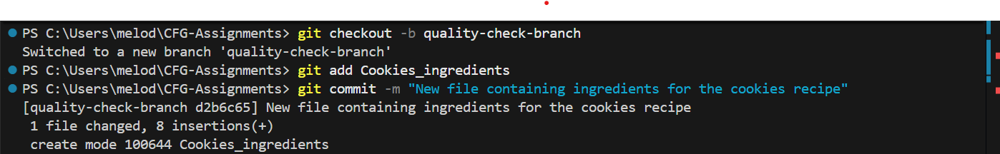
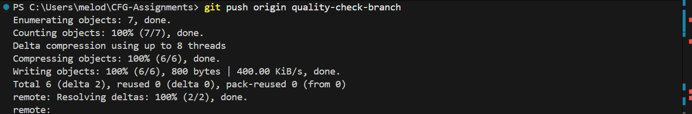

# Welcome! My name is Melody. Here's a little intro..
## This assignment is to display understanding of Git and GitHub
In this project I will create a repo and practice git commands such as creating and merging branches, adding commits, and opening pull requests. I will later add screenshots of my process to this README file once I complete those tasks. 

This is me returning back to the README after complete the tasks. 
I also included a .gitignore file, which tells git that the file should be intentionally untracked.
This is useful for hidden or temporary files. 

Finally, I added a requirements.txt file, which is empty in this case, but is usually a file that lists external libraries and packages required for a project to run.

Here are some screenshots of my process..

## About me:
I am a **23 year old** girl from **Nigeria**. I studied **Business Management** at University, but knew I had an interest in tech since I was 18.
The first week of the CFG degree has been good so far. I did have to miss one session already (*sorry!*), but I caught up on the content asap. By the time this degree is completed, I hope I'll... 
- know how to bake cookies
- have abs
- be ready to start a career in software engineering

Anyways, let the assignment commence. Git is so ~~difficult to grasp~~ fun! God bless whoever created it. 

# Assignment 2 - Using APIs in Python 

## Project overview 

This project will be called: “Which Studio Ghibli Movie Should You Watch?”. It is a console application that recommends a Studio Ghibli movie to the user based on how they felt today. 

### Breakdown

* Call the Studio Ghibli API to fetch movie data
* Ask the user how their day went. Options are provided
* Filter movies by tagging genres then matching each genre with each mood option
* Randomly selct a movie if multiple matches are found
* Display a custom message recommending a movie based on matched genre
* Save results in a presentable format to a file

### API used

'https://ghibliapi.vercel.app/films'

* This API returns information about all of the Studio Ghibli films.
* This API does not require an API key. 

### Dependencies 

* requests (makes a GET request)
* pyfiglet (converts text to ASCII art)

### Improvements 

* Further research into other features that could be implemented to cut down code. Felt like it was too wordy e.g. multiple long 'if..else' statements
* Consider how this could be done on a larger scale. Had to slice from 22 total movies to 12 to be more time efficient. What if there were 100 movies?