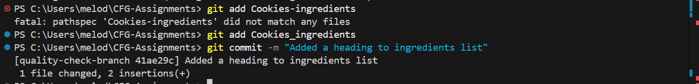

# Welcome! My name is Melody. Here's a little intro..
## This assignment is to display understanding of Git and GitHub
In this project I will create a repo and practice git commands such as creating and merging branches, adding commits, and opening pull requests. I will later add screenshots of my process to this README file once I complete those tasks. 

This is me returning back to the README after complete the tasks. 
I also included a .gitignore file, which tells git that the file should be intentionally untracked.
This is useful for hidden or temporary files. 

Finally, I added a requirements.txt file, which is empty in this case, but is usually a file that lists external libraries and packages required for a project to run.

Here are some screenshots of my process..

## About me:
I am a **23 year old** girl from **Nigeria**. I studied **Business Management** at University, but knew I had an interest in tech since I was 18.
The first week of the CFG degree has been good so far. I did have to miss one session already (*sorry!*), but I caught up on the content asap. By the time this degree is completed, I hope I'll... 
- know how to bake cookies
- have abs
- be ready to start a career in software engineering

Anyways, let the assignment commence. Git is so ~~difficult to grasp~~ fun! God bless whoever created it. 