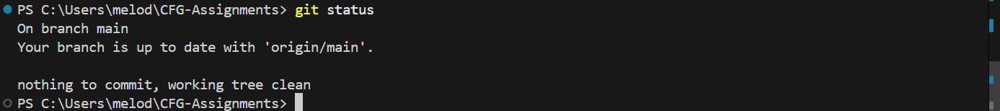
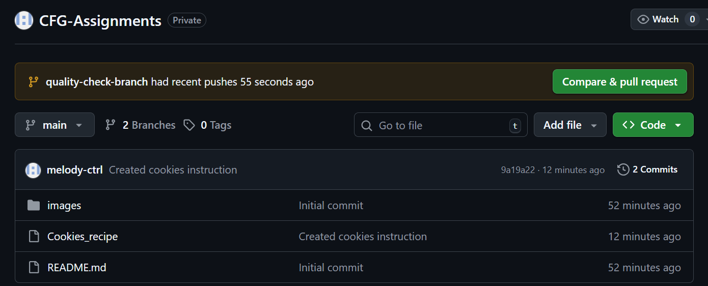

# Welcome! My name is Melody. Here's a little intro..
## This assignment is to display understanding of Git and GitHub
In this project I will create a repo and practice git commands such as creating and merging branches, adding commits, and opening pull requests. I will later add screenshots of my process to this README file once I complete those tasks. 

This is me returning back to the README after complete the tasks. 
I also included a .gitignore file, which tells git that the file should be intentionally untracked.
This is useful for hidden or temporary files. 

Finally, I added a requirements.txt file, which is empty in this case, but is usually a file that lists external libraries and packages required for a project to run.

Here are some screenshots of my process..

## About me:
I am a **23 year old** girl from **Nigeria**. I studied **Business Management** at University, but knew I had an interest in tech since I was 18.
The first week of the CFG degree has been good so far. I did have to miss one session already (*sorry!*), but I caught up on the content asap. By the time this degree is completed, I hope I'll... 
- know how to bake cookies
- have abs
- be ready to start a career in software engineering

Anyways, let the assignment commence. Git is so ~~difficult to grasp~~ fun! God bless whoever created it. 

# Assignment 2 - Using APIs in Python 

## Project overview 

This project will be called: “Which Studio Ghibli Movie Should You Watch?”. It is a console application that recommends a Studio Ghibli movie to the user based on how they felt today. 

### Breakdown

* Call the Studio Ghibli API to fetch movie data
* Ask the user how their day went. Options are provided
* Filter movies by tagging genres then matching each genre with each mood option
* Randomly selct a movie if multiple matches are found
* Display a custom message recommending a movie based on matched genre
* Save results in a presentable format to a file

### API used

'https://ghibliapi.vercel.app/films'

* This API returns information about all of the Studio Ghibli films.
* This API does not require an API key. 

### Dependencies 

* requests (makes a GET request)
* pyfiglet (converts text to ASCII art)

### Future improvements 

* Further research into other features that could be implemented to cut down code. Felt like it was too wordy e.g. multiple long 'if..else' statements. In hindsight, my if loop pairing choice with genres in lines 86-95 could've just been a dictionary...
* Consider how this could be done on a larger scale. Had to slice from 22 total movies to 12 to be more time efficient. What if there were 100 movies?

# Assignment 3 - Data and MySQL 

## Project Overview

This project will be called "The Hairstylist Booking platform". It is an SQL database that can be used for a booking page where customers book hair services with a local stylist. It includes tables for stylists, customers, services, and bookings, and shows how they are connected. 

This scenario is for a centralised booking platform for black hairstylists in particular. Currently, many present their businesses informally on social media platforms, making it difficult for a customer to search and filter for stylists based on important things like price, location, and services offered. A centralised page and database with all this information would help to solve this problem. 

### Breakdown 

* Find stylists offering a specific service
* Let a customer filter stylists by availability
* Create a new booking and show a booking confirmation message
* Price comparisons with other stylists from a stylist's pov
* Update prices of services a stylist provides 
* Delete bookings a stylist can no longer make

### Software used

- MySQL
- SQL client : DBeaver 

### Assumptions 

This scenario was very simplified to match my skill set. In reality there are certain extra features that would be needed for it to run smoothly. For example, duration times for appointment slots depending on the service being provided. For simplicity, I made the assumption that every appointment is 1 hour long. 

### Future Improvements

I hope to increase my skills and be able to return to flesh out this project into something that can realistically be used for a hair booking app for black girls. 

# Assignment 4 - Creating APIs in Python

This project will be called "Travel tracker API", a simple flask API implemented in Python and connected to a MYSQL database.
This scenario shows a tracking platform where a user wants to keep track of their travel plans. The platform will allow them to:
- Create new trips (POST request)
- View all trips (GET request)
- Update existing trips (PUT request)

### Dependencies 

- mysql-connector-python (connects python to mysql database)
- requests (makes a GET request)
- flask (to run our routes)

### How to run this API

1. Install the modules listed in Dependencies 
2. Configure your own config file using config_template.py. Ensure to leave the database parameter as "travel_tracker". Change everything else to your credentials.
3. Run the flask app on the app.py file. You should see something like: "running on http://127.0.0.1:5000"
4. In a separate terminal, run the client side through main.py file. You should see:
- Status codes (200, 201)
- JSON responses
- Confirmation messages

### Future improvements

- Retrieve trips again after PUT request for further confirmation of update. Just did not have enough time.
- Add DELETE endpoint to remove trips
- Add validation for dates and inputs
